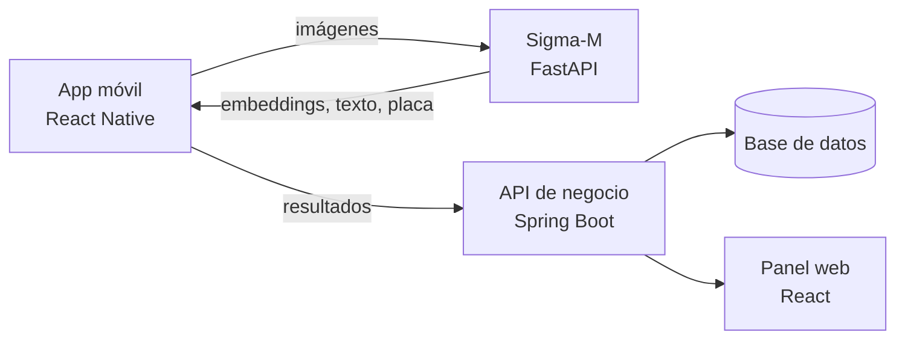

# Sigma-M

Servicio de verificación de identidad para el retiro de motocicletas en estacionamientos. Expone una API REST que, a partir de fotografías, realiza tres análisis independientes:

- **Reconocimiento facial**: detección de rostros, extracción de vectores característicos (*embeddings*) y comparación por similitud coseno.
- **Lectura de identificación oficial**: OCR de credenciales mexicanas (INE) para extraer nombre, CURP y fecha de nacimiento, y detección del rostro impreso en el documento.
- **Lectura de placas**: localización de la placa en la imagen y reconocimiento de sus caracteres.

El objetivo es cubrir una carencia habitual: en un estacionamiento no existe un mecanismo que confirme que quien retira la motocicleta es realmente su propietario.


---

## Contenido

1. [Arquitectura](#arquitectura)
2. [Requisitos](#requisitos)
3. [Instalación](#instalación)
4. [Configuración](#configuración)
5. [Ejecución](#ejecución)
6. [Referencia de la API](#referencia-de-la-api)
7. [Flujo de verificación](#flujo-de-verificación)
8. [Seguridad](#seguridad)
9. [Estructura del proyecto](#estructura-del-proyecto)
10. [Limitaciones conocidas](#limitaciones-conocidas)
11. [Solución de problemas](#solución-de-problemas)

---

## Arquitectura

Sigma-M es el **servicio analizador** del sistema. No guarda datos: recibe imágenes, devuelve resultados estructurados y descarta el contenido. La persistencia y la lógica de negocio corresponden a otras capas.



Dentro del servicio, cada capacidad sigue la misma separación por capas:

```
routes/      Endpoints HTTP y validación de entrada
services/    Lógica de análisis (InsightFace, OpenCV, Tesseract)
schemas/     Contratos de entrada y salida (Pydantic)
core/        Configuración y autenticación
Utils/       Lectura y validación de imágenes
reports/     Configuración de logs
```

---

## Requisitos

| Componente | Versión / nota |
|---|---|
| Python | 3.11 o superior |
| Tesseract OCR | 5.x, con el paquete de idioma **español** (`spa`) |
| CPU | Suficiente con CPU; la inferencia se ejecuta con `CPUExecutionProvider` |
| Memoria | Se recomiendan 4 GB libres para cargar el modelo facial |

### Instalar Tesseract

**Windows**: instala el binario desde el [instalador de UB Mannheim](https://github.com/UB-Mannheim/tesseract/wiki), marca el idioma *Spanish* y agrega la carpeta de instalación al `PATH`.

**Debian / Ubuntu**

```bash
sudo apt install tesseract-ocr tesseract-ocr-spa
```

**macOS**

```bash
brew install tesseract tesseract-lang
```

Comprueba la instalación:

```bash
tesseract --list-langs   # debe incluir "spa"
```

---

## Instalación

```bash
git clone https://github.com/Proximalbag3226/Sigma-m.git
cd Sigma-m

python -m venv .venv
# Windows
.venv\Scripts\activate
# Linux / macOS
source .venv/bin/activate

pip install fastapi "uvicorn[standard]" python-multipart pydantic-settings \
            insightface onnxruntime opencv-python-headless numpy pillow pytesseract
```

> Fija las versiones en un `requirements.txt` antes de desplegar, para que las construcciones sean reproducibles.

En la primera ejecución, InsightFace descarga el modelo configurado en `FACE_MODEL` y lo guarda en `~/.insightface/models`. Necesita conexión a internet solo esa vez.

---

## Configuración

La configuración se lee de variables de entorno o de un archivo `.env` en la raíz del proyecto (`pydantic-settings`).

| Variable | Valor por defecto | Descripción |
|---|---|---|
| `SERVICE_NAME` | `sigma-m-verification-python` | Nombre que aparece en la documentación de la API |
| `ENVIRONMENT` | `dev` | Con `production` se desactiva la documentación interactiva |
| `API_KEY` | *valor de ejemplo* | Clave exigida en el encabezado `api-key`. **Cámbiala siempre** |
| `MAX_UPLOAD` | `8388608` | Tamaño máximo por imagen, en bytes (8 MB) |
| `ALLOWED_CONTENT_TYPES` | `["image/jpg","image/png"]` | Tipos MIME aceptados, como arreglo JSON |
| `FACE_MODEL` | `buffalo_l` | Paquete de modelos de InsightFace |
| `FACE_SIZE` | `640` | Lado de la imagen de detección, en píxeles |
| `FACE_MATCH` | `0.48` | Umbral de similitud coseno para considerar que dos rostros coinciden |
| `LOG` | `INFO` | Nivel de registro |

Ejemplo de `.env`:

```env
ENVIRONMENT=production
API_KEY=genera-una-clave-larga-y-aleatoria
MAX_UPLOAD=8388608
ALLOWED_CONTENT_TYPES=["image/jpeg","image/png"]
FACE_MODEL=buffalo_l
FACE_MATCH=0.48
LOG=INFO
```

Para generar una clave segura:

```bash
python -c "import secrets; print(secrets.token_urlsafe(48))"
```

---

## Ejecución

Desarrollo:

```bash
uvicorn main:app --reload
```

Red local (para probar desde un emulador o un celular):

```bash
uvicorn main:app --host 0.0.0.0 --port 8000
```

Con `ENVIRONMENT` distinto de `production`, la documentación interactiva queda disponible en `http://localhost:8000/docs`.

Verificación rápida:

```bash
curl http://localhost:8000/health
# {"status":"ok"}
```

---

## Referencia de la API

Todos los endpoints, salvo `/health`, requieren el encabezado:

```
api-key: <API_KEY>
```

Las imágenes se envían como `multipart/form-data`. Los formatos admitidos se definen en `ALLOWED_CONTENT_TYPES`.

| Método | Ruta | Campo | Descripción |
|---|---|---|---|
| `GET` | `/health` | n/a | Estado del servicio. No requiere clave |
| `POST` | `/document/extract` | `document` | Extrae texto y rostro de una identificación |
| `POST` | `/face/embed` | `file` | Detecta el rostro principal y devuelve su vector |
| `POST` | `/face/compare` | JSON | Compara dos vectores faciales |
| `POST` | `/plate/plate` | `file` | Localiza y lee una placa |

### `POST /face/embed`

```bash
curl -X POST http://localhost:8000/face/embed \
  -H "api-key: $API_KEY" \
  -F "file=@selfie.png;type=image/png"
```

```json
{
  "Face_detected": true,
  "detection_confidence": 0.99,
  "bounding_box": { "x1": 120.4, "y1": 88.1, "x2": 340.9, "y2": 355.2 },
  "embedding": [0.012, -0.044, "... 512 valores ..."]
}
```

Si hay varios rostros se devuelve el de mayor área. Sin rostro, `Face_detected` es `false` y los demás campos son `null`.

### `POST /face/compare`

```bash
curl -X POST http://localhost:8000/face/compare \
  -H "api-key: $API_KEY" \
  -H "Content-Type: application/json" \
  -d '{"face1": [0.012, "..."], "face2": [0.010, "..."]}'
```

```json
{
  "similarity": 0.62,
  "is_match": true,
  "threshold_used": 0.48
}
```

`similarity` es la similitud coseno entre ambos vectores, en el rango de -1 a 1. `is_match` es verdadero cuando alcanza el umbral `FACE_MATCH`.

### `POST /document/extract`

```bash
curl -X POST http://localhost:8000/document/extract \
  -H "api-key: $API_KEY" \
  -F "document=@ine.png;type=image/png"
```

Devuelve el tipo de documento, el nombre completo, la CURP, la fecha de nacimiento, la confianza del OCR y los datos del rostro impreso en la credencial (detección, vector y caja delimitadora). Los campos no localizados se devuelven como `null`.

> Consulta `/docs` para ver los nombres exactos de los campos de la versión desplegada.

### `POST /plate/plate`

```bash
curl -X POST http://localhost:8000/plate/plate \
  -H "api-key: $API_KEY" \
  -F "file=@placa.png;type=image/png"
```

```json
{
  "plate_detected": true,
  "plate_text": "ABC123"
}
```

### Códigos de error

| Código | Causa |
|---|---|
| `400` | Archivo vacío, ilegible o mayor que `MAX_UPLOAD` |
| `401` | Clave de API ausente o incorrecta |
| `413` | Cuerpo de la petición mayor que el límite permitido |
| `415` | Tipo de archivo no incluido en `ALLOWED_CONTENT_TYPES` |
| `422` | Petición mal formada o campo faltante |
| `500` | Error interno; el detalle se registra en el log, no se expone al cliente |

---

## Flujo de verificación

Una verificación de retiro combina los endpoints así:

1. **Identificación**: `/document/extract` para leer los datos y `/face/embed` sobre la misma foto para obtener el vector del rostro de la credencial.
2. **Rostro en vivo**: `/face/embed` sobre la fotografía tomada a quien retira la motocicleta.
3. **Comparación**: `/face/compare` con ambos vectores. Si `is_match` es verdadero, el rostro coincide con la credencial.
4. **Placa**: `/plate/plate` sobre la fotografía de la motocicleta, para contrastarla con la placa registrada del propietario.

El resultado apoya la decisión del operador; no la sustituye.

---

## Seguridad

- **Autenticación**: clave de API comparada en tiempo constante (`hmac.compare_digest`).
- **Validación de entrada**: se verifican tipo MIME, tamaño y que el archivo pueda decodificarse como imagen antes de procesarlo.
- **Límite de cuerpo**: un middleware rechaza peticiones que superen `MAX_UPLOAD` con `413`.
- **Errores genéricos**: las excepciones no controladas devuelven `500` sin detalles internos y quedan en el registro.
- **Documentación**: `/docs` se desactiva cuando `ENVIRONMENT=production`.
- **Sin persistencia**: las imágenes se procesan en memoria y no se almacenan.

Recomendaciones para producción:

- Servir detrás de un proxy inverso con **HTTPS** (Nginx, Caddy o similar).
- Definir `API_KEY` por variable de entorno, rotarla periódicamente y no versionarla.
- Limitar el acceso por red o IP a los clientes autorizados y aplicar límites de tasa.
- Tratar los vectores faciales y los datos de la identificación como **datos personales sensibles**: cifrarlos en reposo, restringir el acceso y definir una política de retención conforme a la normativa aplicable.
- Excluir del repositorio `.venv/`, `.idea/`, `__pycache__/` y `.env` mediante `.gitignore`.

---

## Estructura del proyecto

```
Sigma-m/
├── main.py                    Aplicación FastAPI, middleware y manejo de errores
├── core/
│   ├── config.py              Configuración (variables de entorno)
│   └── security.py            Verificación de la clave de API
├── routes/
│   ├── document.py            /document/extract
│   ├── face.py                /face/embed, /face/compare
│   ├── plate.py               /plate/plate
│   └── health.py              /health
├── services/
│   ├── document_service.py    OCR y extracción de datos de la identificación
│   ├── face_service.py        Detección, vectores y similitud facial
│   └── plate_service.py       Localización y lectura de placas
├── schemas/                   Modelos Pydantic de entrada y salida
├── Utils/
│   └── image.py               Lectura y validación de imágenes
└── reports/
    └── logs_config.py         Configuración de logs
```

---

## Limitaciones conocidas

- **Sin detección de vida (*liveness*)**: una fotografía impresa o en pantalla podría presentarse como rostro real. Para entornos de alto riesgo conviene añadir esta verificación.
- **Lectura de placas heurística**: la localización se basa en contornos y proporciones, y el OCR depende de la iluminación y el encuadre. La lectura debe confirmarse visualmente.
- **Documento soportado**: el extractor está pensado para la credencial INE; otros documentos requieren ajustes.
- **Un solo rostro por imagen**: se usa el de mayor área.
- **Inferencia en CPU**: la primera petición es lenta porque carga el modelo; las siguientes son considerablemente más rápidas.

---

## Solución de problemas

| Síntoma | Posible causa y solución |
|---|---|
| `401 Invalid API key` | El encabezado debe llamarse `api-key` y coincidir con `API_KEY` |
| `415 File type not allowed` | Agrega el tipo MIME real de la imagen a `ALLOWED_CONTENT_TYPES` |
| `TesseractNotFoundError` | Tesseract no está instalado o no está en el `PATH` |
| OCR sin texto o con errores | Falta el idioma `spa`, o la foto está borrosa o con reflejos |
| Error al cargar el modelo facial | Verifica el nombre en `FACE_MODEL` y la conexión en la primera ejecución |
| Primera petición muy lenta | Carga inicial del modelo; es esperable |
| `ImportError: python-multipart` | Instala `python-multipart` para recibir archivos |

---

## Autor

**Luis** · [@Proximalbag3226](https://github.com/Proximalbag3226)

## Licencia

Define aquí la licencia del proyecto (por ejemplo MIT) y agrega el archivo `LICENSE` a la raíz del repositorio.
